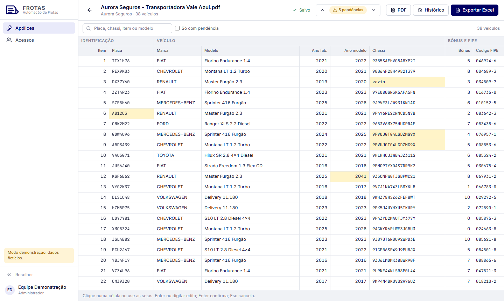
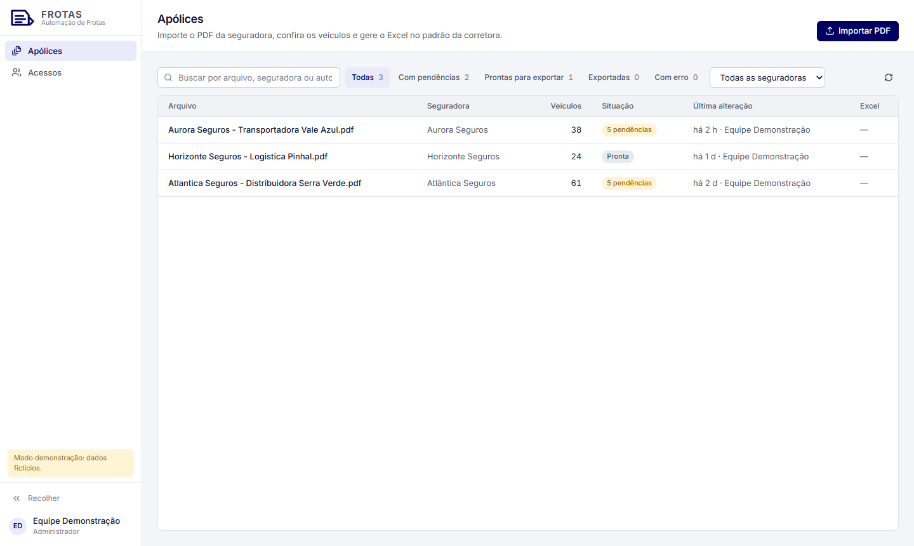
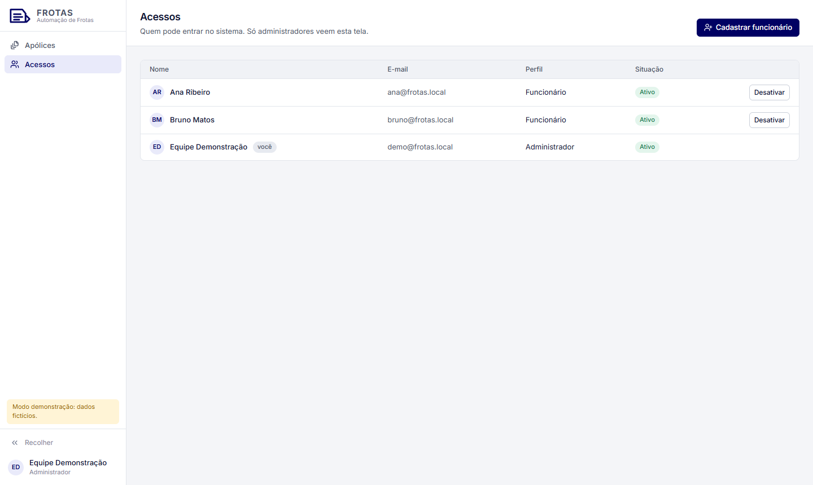
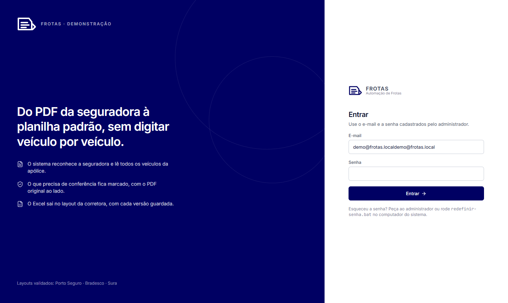
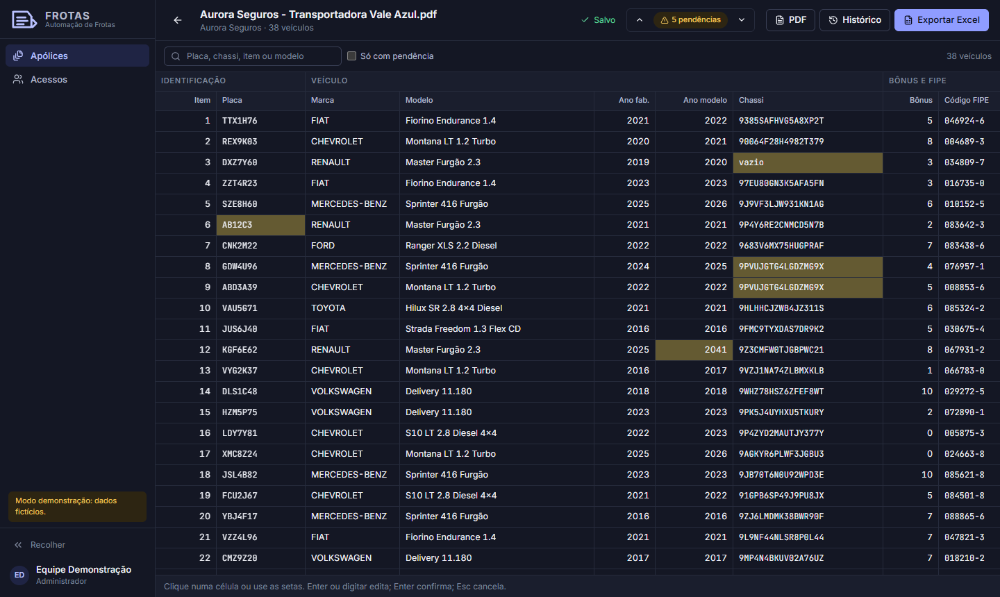
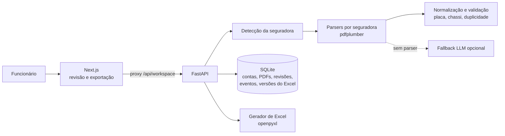

# Automação de Frotas

**Sistema interno que transforma apólices de frota em PDF numa planilha Excel padronizada, com revisão humana antes da exportação.**

Feito para uma corretora de seguros de Curitiba. Antes dele, a equipe abria o PDF de cada seguradora e copiava veículo por veículo para o Excel. Uma frota de 150 veículos levava horas e acumulava erros de digitação.



> As telas usam o **modo demonstração**: seguradoras, empresas, placas e chassis são fictícios. A marca também foi trocada por uma neutra: nenhum dado ou identidade do cliente está neste repositório.

---

## Como funciona

1. **Importar.** O funcionário envia um ou vários PDFs de uma vez. O sistema identifica a seguradora pelo layout e extrai todos os veículos.
2. **Revisar.** Os 17 campos do padrão da corretora aparecem numa tabela editável. O que o sistema não conseguiu confirmar (campo vazio, placa ou chassi inválido, ano impossível, valor repetido) fica marcado com **marca-texto amarelo**, só na célula afetada.
3. **Conferir.** O PDF original abre ao lado da tabela. Setas pulam de pendência em pendência, a tabela funciona como planilha (setas, Enter, Tab, Esc) e cada correção é salva sozinha.
4. **Exportar.** O Excel sai no layout exigido pela corretora. Cada exportação vira uma versão guardada, com autor e data.

| Lista de apólices | Gestão de acessos |
| --- | --- |
|  |  |

| Tela de entrada | Modo escuro |
| --- | --- |
|  |  |

## Seguradoras suportadas

Cada seguradora tem um parser determinístico próprio, validado contra PDFs reais por testes de gabarito. Esses PDFs e os testes que dependem deles ficam fora deste repositório, porque contêm dados de clientes:

| Seguradora | Layout | Veículos no teste | O que o teste verifica |
| --- | --- | ---: | --- |
| Porto Seguro | Relação de itens completa | 17 | Gabarito integral |
| Porto Seguro | Detalhado por item | 100 | Contagem, identidade e amostras críticas |
| Bradesco | Seguro RCF | 152 | Contagem e amostras do início, meio e fim |
| Sura | Auto Frota | 42 | Contagem, franquia de casco, bônus e coberturas |

Para um layout sem parser, existe um fallback opcional por LLM (Anthropic ou OpenAI), desligado por padrão.

## Arquitetura



**Decisões que valem destacar**

- **Revisão nunca sobrescreve sem querer.** Cada salvamento carrega o número da revisão; se outra pessoa salvou antes, a API recusa e a tela oferece recarregar.
- **Exportações imutáveis.** Cada Excel gerado é guardado como versão própria; editar o documento depois não altera o que já foi enviado.
- **Validação nos dois lados.** As regras do backend (formato de placa Mercosul, chassi de 17 caracteres, faixa de anos, duplicidade) são repetidas no navegador, então a marcação some no instante da correção.
- **Segurança do piloto.** Senhas com scrypt e salt, sessão em cookie HttpOnly e SameSite=Strict, bloqueio após 5 tentativas, cadastro de funcionários só pelo administrador.

## Tecnologias

- **Frontend:** Next.js 16, React 19, TypeScript, Tailwind CSS 4 (sem biblioteca de componentes; temas claro e escuro)
- **Backend:** Python, FastAPI, pdfplumber, openpyxl, Pydantic
- **Dados:** SQLite (piloto local)
- **Testes:** unittest (os de gabarito com PDFs reais rodam só na cópia privada)

## Rodar localmente (Windows)

Pré-requisitos: [Python 3.13](https://www.python.org/downloads/) e [Node.js LTS](https://nodejs.org).

**Do jeito fácil:** dois cliques em `iniciar-frotas.bat`. Na primeira vez ele cria o ambiente do Python, instala tudo, sobe a API e o site e abre o navegador em `http://127.0.0.1:3001`.

**Para ver com dados fictícios:** dois cliques em `iniciar-demo.bat`. Ele cria um banco separado só com dados inventados e um aviso de demonstração. Entre com `demo@frotas.local` e a senha `demonstracao-frotas`.

**Manualmente:**

```powershell
# API (raiz do projeto)
py -3.13 -m venv .venv
.venv\Scripts\pip.exe install -r src\requirements.txt
.venv\Scripts\python.exe -m uvicorn main:app --app-dir src --host 127.0.0.1 --port 8000

# Interface (outro terminal)
cd src\web
npm install
npm run dev -- --hostname 127.0.0.1 -p 3001
```

Esqueceu a senha de administrador? Rode `redefinir-senha.bat`.

## Testes

```powershell
.venv\Scripts\python.exe -m unittest discover -s tests -v
```

Os testes deste repositório cobrem validação, pendências, exportação revisada, carga dos parsers e o workspace (acesso, revisões, conflito, versões). Os testes de gabarito por seguradora usam PDFs reais e ficam na cópia privada.

## Estrutura

```
src/
  core/          detecção, parsers por seguradora, normalização, gerador de Excel, fallback LLM
  api/           rotas de extração e Excel
  workspace/     contas, sessões, documentos, revisões, histórico, versões e contagem de pendências
  web/           interface (Next.js): login, apólices, revisão, histórico, acessos
scripts/         banco de demonstração e redefinição de senha
tests/           testes de validação, exportação e workspace
docs/            regras de negócio, arquitetura, mapa de telas e próximos passos
```

## Próximos passos

- **Envio agendado** das planilhas para os portais das seguradoras, que só aceitam o envio de madrugada. O plano está em [`docs/ENVIO-AUTOMATICO.md`](docs/ENVIO-AUTOMATICO.md) e depende do canal oferecido por cada seguradora.
- Hospedagem contínua com backup, para tirar o sistema do computador local.
- Novos layouts conforme a corretora trouxer outras seguradoras.

---

Desenvolvido por **Raphael Scharf Passos**, estudante de Engenharia de Software na Universidade Positivo.
[LinkedIn](https://www.linkedin.com/in/raphaelscharf/) · [GitHub](https://github.com/rfz611) · [Portfólio](https://raphaelscharf.vercel.app)
