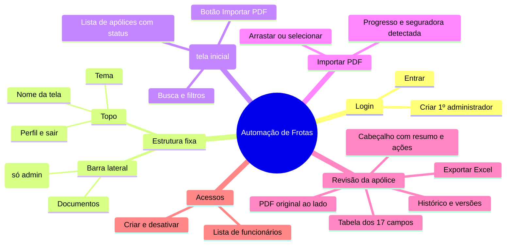

# Mapa de Telas — Automação de Frotas (nova interface)

> Rascunho de 10/11/2026. Objetivo: definir **o que existe em cada tela antes de desenhar**, para não criar seções sem necessidade.
> Regra de ouro: **se uma tela não ajuda o funcionário a importar → revisar → exportar, ela não entra agora.**

## Visão geral

## Fluxo principal (o caminho que mais importa)

**Documentos → Importar PDF → Revisão → Exportar Excel → volta para Documentos**

---

## 0. Login
- Campos: e-mail e senha · botão **Entrar**.
- Primeira vez (sem usuários): tela **Criar administrador** (nome, e-mail, senha).
- Nada além disso.

## 1. Estrutura fixa (aparece em todas as telas logadas)
**Barra lateral** (recolhível)
- 📁 **Documentos** — tela inicial.
- 👥 **Acessos** — só para administrador.
- ❌ Sai da barra: "Extração de frotas" deixa de ser item de menu. A extração é uma etapa que se abre a partir de um documento, não um lugar para onde se navega vazio.

**Topo**
- Título da tela atual (ex.: "Documentos", ou nome da apólice na revisão).
- Alternar tema (claro/escuro) · avatar → menu: foto de perfil, tema, sair.

## 2. Documentos (tela inicial)
- Botão principal: **Importar PDF** (único botão de destaque da tela).
- Busca: nome do arquivo, seguradora ou placa.
- Filtros rápidos (chips): Todos · Com pendências · Em revisão · Exportados · por seguradora.
- **Lista/tabela de apólices**, uma por linha:
  - Nome do arquivo · Seguradora · Nº de veículos · Pendências · Status · Última alteração (quem/quando) · Última exportação.
- Clique na linha → abre **Revisão**.
- Estado vazio (nenhum documento): texto curto + botão Importar PDF.

## 3. Importar PDF (janela por cima da tela, não é uma página)
- Área de arrastar/soltar + botão "Selecionar arquivos" (aceita vários).
- Para cada arquivo: barra de progresso → seguradora detectada → nº de veículos encontrados (ou erro claro: "Layout não reconhecido").
- Ao terminar 1 arquivo: botão **Revisar**. Vários arquivos: voltam para a lista de Documentos com status "Em revisão".

## 4. Revisão da apólice (coração do sistema)
**Cabeçalho do documento**
- Nome do arquivo (editável = nome do Excel) · Seguradora · Nº de veículos.
- Contador de pendências (clicável → filtra) · indicador "Salvo automaticamente ✓".
- Ações: **Ver PDF** (abre/fecha painel lateral) · **Histórico** · **Exportar Excel** (botão principal).

**Barra da tabela**
- Busca (placa, chassi, item, modelo) · alternar "Só pendências" · botões ↑ ↓ "Próxima pendência".

**Tabela (17 campos)**
- Colunas fixas à esquerda: Item · Placa.
- Colunas agrupadas com um rótulo acima:
  - **Veículo:** Marca, Modelo, Ano fab., Ano modelo, Chassi, Código de identificação.
  - **Bônus e FIPE:** Classe de bônus, Código FIPE.
  - **Coberturas:** Franquia casco, RCF danos materiais, RCF danos corporais, Danos morais, APP passageiros, Vidros, Assistência.
- Célula com pendência: borda/ícone só na célula + motivo ao passar o mouse.
- Edição direto na célula (Enter salva, Esc cancela).

**Painel lateral "PDF original"** — PDF ao lado da tabela, redimensionável.

**Painel lateral "Histórico"** (mesmo lugar do PDF, um ou outro)
- Linha do tempo: importado, editado (campo, de → para, quem), exportado.
- Versões de Excel exportadas, cada uma com botão Baixar.

**Exportar Excel** (janela de confirmação)
- Nome do arquivo · se houver pendências: aviso "Ainda há N pendências" com opções **Revisar pendências** ou **Exportar mesmo assim**.
- Depois: download + nova versão aparece no Histórico.

## 5. Acessos (só administrador)
- Botão **Adicionar funcionário** (nome, e-mail, senha inicial, papel: Operador/Admin).
- Lista: nome · e-mail · papel · status (ativo/desativado) · último acesso · ação Desativar/Reativar.

---

## Fica para depois (NÃO criar telas agora)
Estão no README como "previstas", mas não entram nesta interface:
- Dashboard / gráficos
- Agendamento de exportações
- Envio automático para seguradoras
- Integrações externas
- Melhoria de parsing com IA
- Login com Google/Microsoft

Quando uma delas virar prioridade, ela ganha uma seção aqui primeiro.

## Perguntas em aberto
1. O que mais incomoda na interface atual? (visual, organização, tamanho das fontes, cores…)
2. Importar vários PDFs de uma vez é comum no dia a dia, ou normalmente é um por vez?
3. Operador comum pode ver documentos de todos, ou só os que ele importou?
